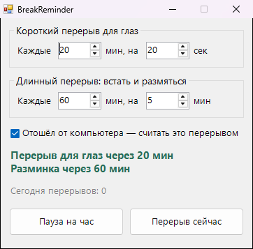

<div align="center">

# 👀 BreakReminder

**Напоминает дать отдых глазам и размяться, пока ты работаешь или играешь**




</div>

## ✨ Возможности

- 👁️ Короткий перерыв для глаз по правилу 20-20-20: каждые 20 минут на 20 секунд посмотреть вдаль
- 🧘 Длинный перерыв раз в час: встать, потянуться, пройтись
- 🖥️ Перерыв показывается на весь экран с таймером обратного отсчёта и подсказкой, что сделать
- 🚶 Если ты сам отошёл от компьютера, это засчитывается как перерыв и таймер начинается заново
- ⏸️ Пауза на час для созвона или игры. `Esc` пропускает перерыв
- ⚙️ Интервалы и длительность настраиваются. Сворачивается в трей

## 💡 Когда пригодится

- Глаза к вечеру красные и сухие
- Спина и шея затекают после нескольких часов за столом
- Засиживаешься за работой или игрой и забываешь встать

## 📥 Установка

1. Скачай `BreakReminder.exe` из раздела [**Releases**](../../releases/latest)
2. Запусти его, установка не нужна

## 🛠️ Сборка из исходников

Нужен только Windows: компилятор C# входит в состав .NET Framework.

```bat
build.bat
```

## 📄 Лицензия

[MIT](LICENSE)
